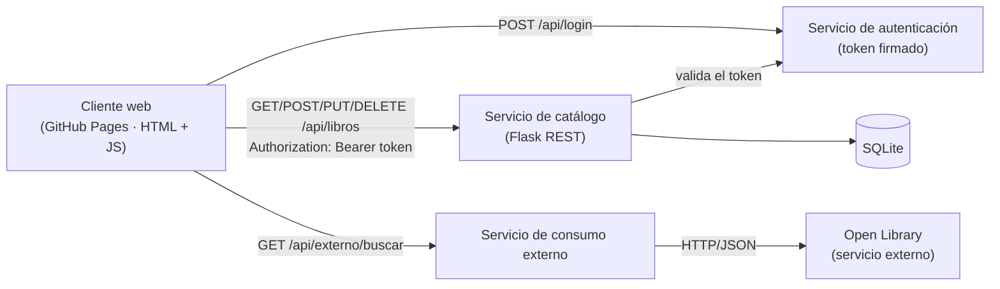
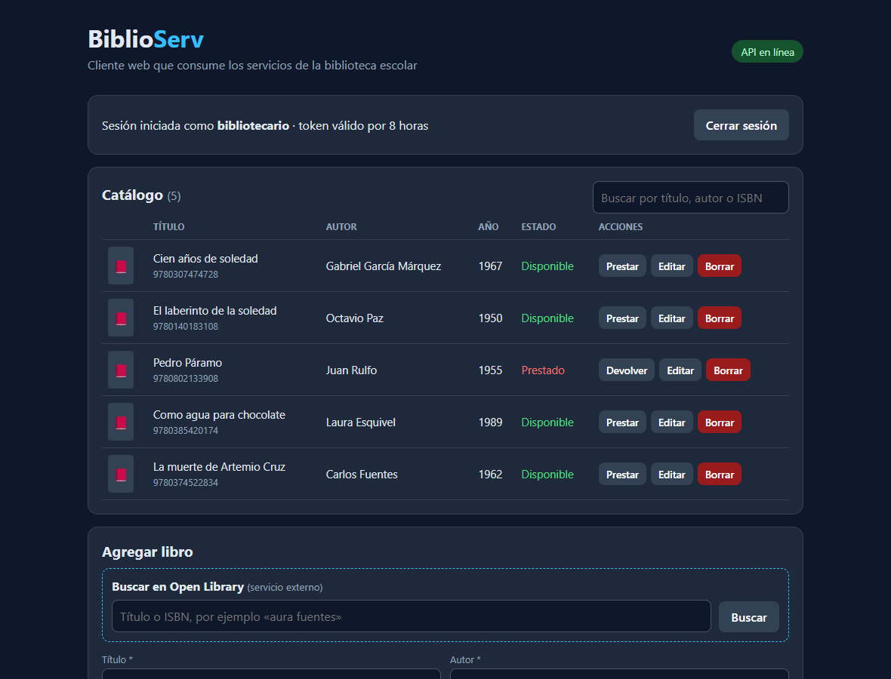
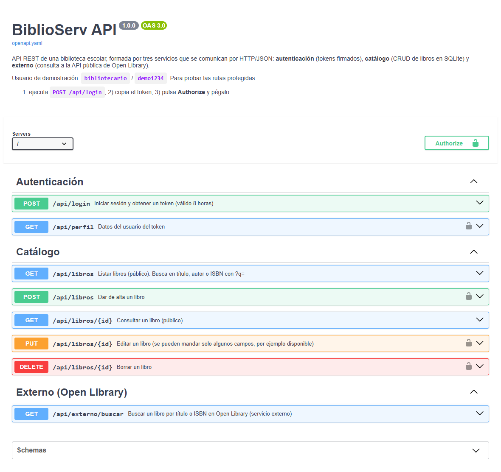
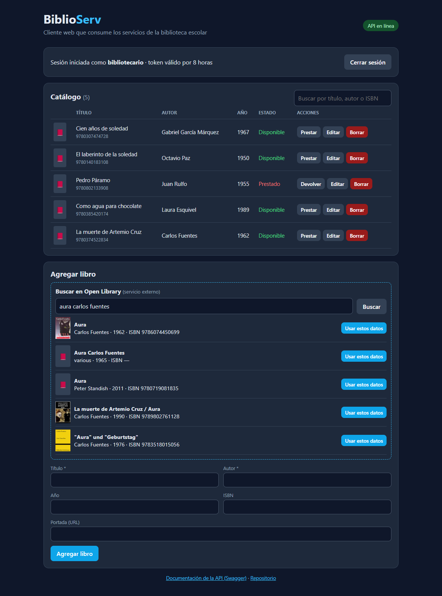
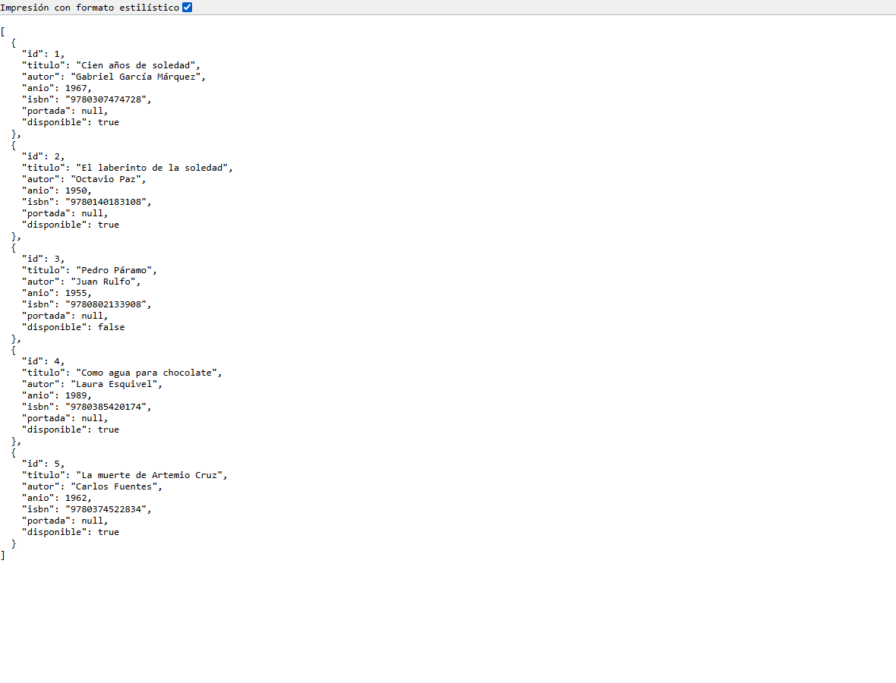

# BiblioServ · Aplicación orientada a servicios

Biblioteca escolar formada por **servicios independientes que se comunican por HTTP/JSON**:
un servicio de **autenticación**, un servicio de **catálogo** (API REST + SQLite), el consumo de un **servicio externo** (Open Library) y un **cliente web** separado que los usa.

> Subproducto No. 6 · Aplicaciones Web Progresivas · Unidad I · Jahir Jaziel Serrano Arana · 10° D

| | Enlace |
|---|---|
| 🌐 Cliente web (GitHub Pages) | **https://jazyelae.github.io/BiblioServ-Servicios/** |
| ⚙️ API (Render) | **https://biblioserv.onrender.com** |
| 📖 Documentación (Swagger) | https://biblioserv.onrender.com/docs |

Usuario de demostración: **bibliotecario** / **demo1234**.

## Arquitectura



Cada servicio es un *blueprint* de Flask en su propio archivo:

| Archivo | Servicio |
|---|---|
| `autenticacion.py` | Login y tokens firmados con `itsdangerous` (caducan en 8 h). Decorador `@requiere_token`. |
| `catalogo.py` | CRUD de libros con validación (400) y 404. Leer es público; escribir requiere token. |
| `externo.py` | Consulta la API de Open Library por título o ISBN y simplifica la respuesta. |
| `basedatos.py` | SQLite: crea la tabla y los 5 libros de ejemplo al arrancar. |
| `app.py` | Une los servicios, configura CORS, la documentación y los errores en JSON. |
| `cliente/` | Cliente web (HTML + CSS + JS con `fetch`), publicado en GitHub Pages. |

## Endpoints

| Método | Ruta | Token | Descripción | Respuestas |
|---|---|---|---|---|
| POST | `/api/login` | — | Inicia sesión y devuelve un token | 200 · 401 |
| GET | `/api/perfil` | ✔ | Usuario del token | 200 · 401 |
| GET | `/api/libros?q=` | — | Lista y búsqueda por título, autor o ISBN | 200 |
| GET | `/api/libros/<id>` | — | Un libro | 200 · 404 |
| POST | `/api/libros` | ✔ | Alta (`titulo` y `autor` obligatorios) | 201 · 400 · 401 |
| PUT | `/api/libros/<id>` | ✔ | Edición parcial (por ejemplo `{"disponible": false}`) | 200 · 400 · 401 · 404 |
| DELETE | `/api/libros/<id>` | ✔ | Borrar | 204 · 401 · 404 |
| GET | `/api/externo/buscar?q=` | — | Busca en Open Library | 200 · 400 · 502 |

El token se envía en el encabezado `Authorization: Bearer <token>`. La especificación completa está en [`docs/openapi.yaml`](docs/openapi.yaml) y se ve con Swagger UI en `/docs`.

### Ejemplo con curl
```bash
curl https://biblioserv.onrender.com/api/libros
TOKEN=$(curl -s -X POST https://biblioserv.onrender.com/api/login -H "Content-Type: application/json" \
  -d '{"usuario":"bibliotecario","password":"demo1234"}' | python -c "import json,sys;print(json.load(sys.stdin)['token'])")
curl -X POST https://biblioserv.onrender.com/api/libros -H "Authorization: Bearer $TOKEN" \
  -H "Content-Type: application/json" -d '{"titulo":"Aura","autor":"Carlos Fuentes","anio":1962}'
```

## Ejecutar en tu computadora
```bash
python -m venv .venv && .venv\Scripts\activate      # en Linux/Mac: source .venv/bin/activate
pip install -r requirements-dev.txt
pytest -v                                           # 14 pruebas de los servicios
python app.py                                       # API en http://127.0.0.1:5000
python -m http.server 8000 --directory cliente      # cliente en http://127.0.0.1:8000
```

## Despliegue
- **API → Render** con [`render.yaml`](render.yaml) (Blueprint): `gunicorn app:app`; `SECRET_KEY` la genera Render.
  - Limitaciones del **plan gratuito**:
    - El servicio **se duerme tras 15 minutos** sin uso y la primera petición tarda cerca de 1 minuto (el cliente muestra «Despertando el servicio…»).
    - El disco es temporal: al reiniciar o dormirse, la base **vuelve a los 5 libros de ejemplo**.
- **Cliente → GitHub Pages** con `.github/workflows/pages.yml` (publica solo `cliente/`).
- **Pruebas** con `.github/workflows/pruebas.yml` en cada push.

## Configuración (variables de entorno)
| Variable | Uso | Valor por defecto (solo desarrollo) |
|---|---|---|
| `SECRET_KEY` | Firma de los tokens | `solo-para-desarrollo` |
| `DEMO_PASSWORD` | Contraseña del usuario de demostración | `demo1234` |
| `ORIGENES_CORS` | Sitios que pueden llamar a la API desde el navegador | Pages + localhost:8000 |
| `BIBLIO_DB` | Ruta del archivo SQLite | `biblioteca.db` |

## Capturas
| Cliente | API |
|---|---|
|  |  |
|  |  |

## Tecnologías
Python 3.12 · Flask 3.1 · SQLite · itsdangerous · flask-cors · requests · gunicorn · pytest · Open Library API · HTML/CSS/JS · Render · GitHub Pages.
